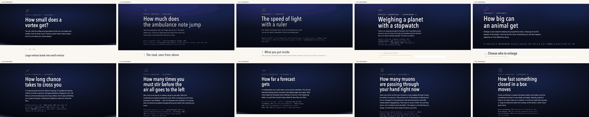
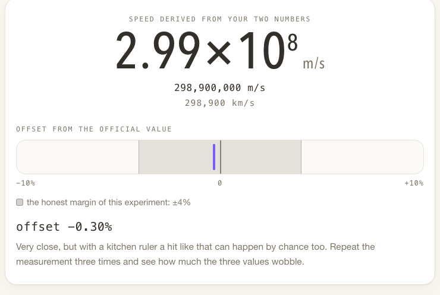
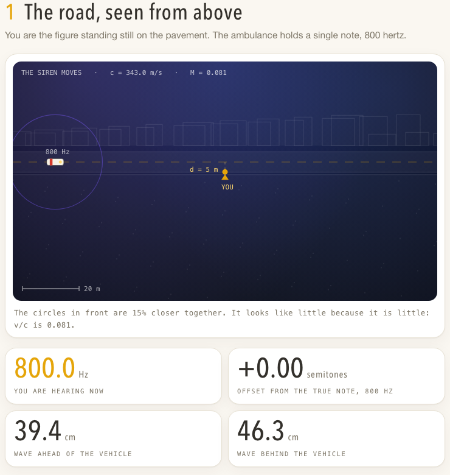
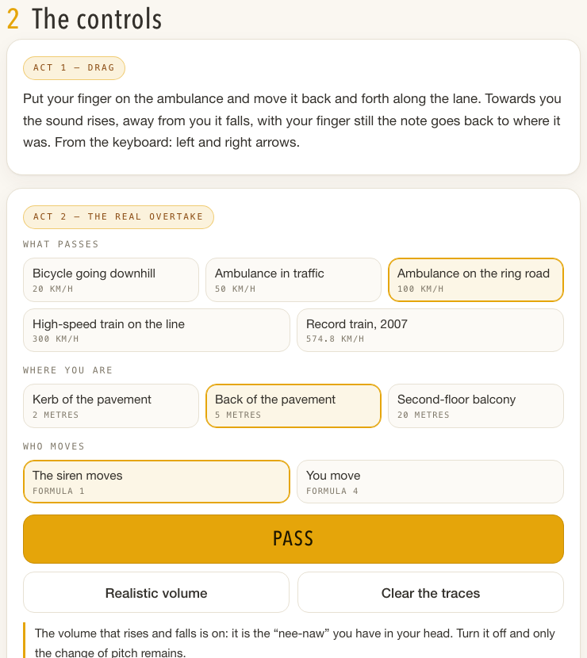
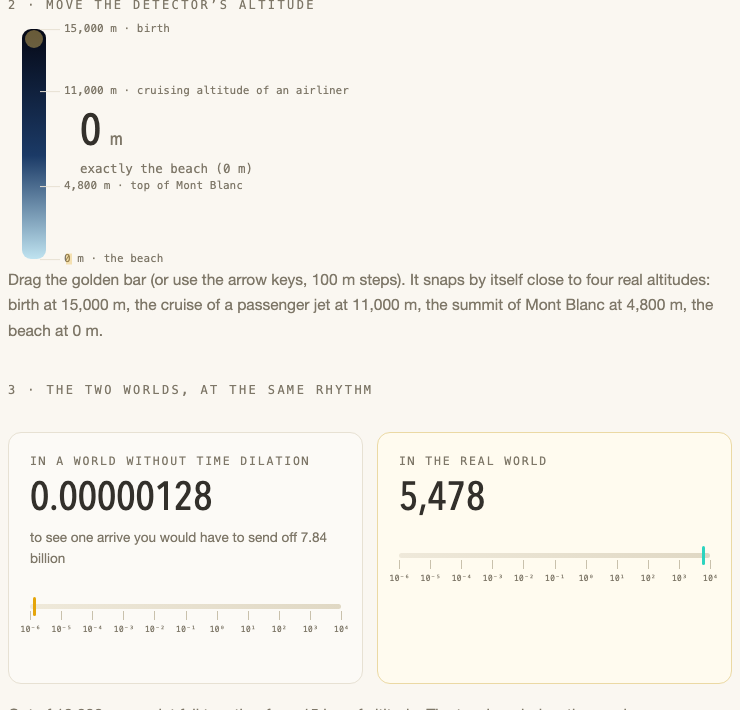

# physics-experiments-lab

Ten interactive experiments. You touch, move and measure, and real numbers change in front of you. Nothing to memorise, just physics you can see happening.

Plain HTML, CSS and JavaScript. No build step, no framework, no network access, no account. Open `index.html` and click.


*Screenshots of the real pages in this repository (see "Images" below).*

## Language

The ten experiment pages are in **English**. This is a first translation: it has not been read by a native English speaker yet, and some long explanatory passages and a few lines of fine print in several pages are still in Italian. Numbers use English formatting (decimal point). Issues and pull requests that fix wording are welcome.

The original, Italian version of the same experiments is the live copy on the site: https://developcontroller.com/laboratorio

## The experiments

| # | Title on the page | File | What you do | The formula behind it (as written on the page) |
|---|-------------------|------|-------------|-----------------------------------------------|
| 1 | How small does a vortex get? | `experiments/microscale.html` | Stir harder and watch the smallest eddy of air: size, speed, lifetime. Then measure the slope of the energy cascade on a graph. | eta = (nu^3 / epsilon)^(1/4), u = (nu epsilon)^(1/4), tau = (nu / epsilon)^(1/2); spectrum slope -5/3 |
| 2 | How much does the ambulance note jump? | `experiments/doppler.html` | Drag an ambulance with your finger, or run the overtake. Move the siren, or move the listener. | f = f0 c / (c - v) approaching, f0 c / (c + v) receding |
| 3 | The speed of light, with a ruler | `experiments/luce_microonde.html` | Melt a chocolate bar in a microwave oven, measure the distance between two spots with a ruler, read the oven frequency, get a speed. | c = 2 d f |
| 4 | Weighing a planet with a stopwatch | `experiments/pesare_pianeta.html` | Time one orbit of the Space Station, the Moon, Io or the Earth and get the mass of the body they orbit. Then make deliberate errors and watch them grow. | M = 4 pi^2 r^3 / (G T^2) |
| 5 | How big can an animal get | `experiments/quadrato_cubo.html` | Scale an ant up. Weight grows with the cube of the length, strength with the square. | relative strength F/P is proportional to 1/k |
| 6 | How long chance takes to cross you | `experiments/caso_attraversa.html` | How long does a molecule of oxygen or sugar, or a blood protein, take to wander across a cell or a metre? | t = x^2 / (2 D), D = k T / (6 pi eta r) |
| 7 | How many times you must stir before the air all goes to the left | `experiments/rimescolare.html` | Reshuffle a box of air until all of it is on the left: 4 molecules, 10, 100, then a breath's worth. | p = 1 / 2^N, delta S = -N k ln 2 |
| 8 | How far a forecast gets | `experiments/previsione.html` | Run one multiplication twice from almost the same start and see when the two forecasts separate. | x(n+1) = 4 x (1 - x), N = log2(1 / d0) |
| 9 | How many muons are passing through your hand right now | `experiments/muoni.html` | Slide the detector altitude and compare a world without time dilation to the real one. | gamma = 1 / sqrt(1 - v^2/c^2), N = N0 exp(-t / tau) |
| 10 | How fast something closed in a box moves | `experiments/scatola.html` | Squeeze an electron, a dust grain or a marble into a smaller and smaller box. | p = h / (2 L), v = p / m |

Nine of the ten pages have a section called "What this model does not say": the limits of the model are part of the experiment, not a footnote. Experiment 1 only has a short note about the blurred boundary of the smallest eddies.









### A note on experiment 3

Since 1983 the metre is *defined* through the speed of light, so this experiment cannot discover a new value of c. The page says so: what you check is your own chain of measurement (ruler, spots, oven frequency) and the fact that a 12 cm wave you cannot see travels at the same speed as visible light. Read the safety line on the page before you switch the oven on: stop at the first spots, the plate gets hot, no metal inside.

## Run it

```bash
git clone https://github.com/CapitanaIcoachai/physics-experiments-lab.git
cd physics-experiments-lab
open index.html          # or double-click it; any modern browser
```

No server needed. If you prefer one: `python3 -m http.server` and open `http://localhost:8000/`.

## Tests

```bash
node tests/check_physics.mjs
# -> 83/83 checks passed
```

`tests/check_physics.mjs` needs Node 18+ and nothing else. It recomputes, from textbook formulas and the constants the pages declare, the headline numbers that the pages state (for example 870.50 Hz and 740.07 Hz for the 100 km/h ambulance, 5569 s for the Space Station orbit, 5478 muons out of 10,000, 1.213 pm for the electron limit) and fails if any differs from what the page says. It is an independent arithmetic check. It is not a peer review.

An optional smoke test loads every page in a simulated browser (jsdom) and runs the microwave calculation:

```bash
npm install
npm run smoke
```

## Status and honesty

- Built with AI help. The calculations have not been reviewed by a physicist yet: issues welcome, especially about the physics.
- The experiments are models. The interactive animations are drawings of the model, not recordings.
- Constants are CODATA values or exact SI definitions, as listed on each page. Nothing is fetched from the internet while the pages run.
- A live copy (Italian, same experiments, may differ slightly from this repository): https://developcontroller.com/laboratorio

## Images

The pictures in `images/` are screenshots of the pages in `experiments/`, taken with a headless Chromium at 1280 px width (the fonts are system fallbacks, because no web font is bundled). The result in `microwave-result.png` is the page's own output for 6.1 cm and 2450 MHz; `overview.png` shows the top of each of the ten pages.

## License

MIT. Copyright (c) 2026 Capitan AI. See `LICENSE` and `THIRD_PARTY_LICENSES.md`.
